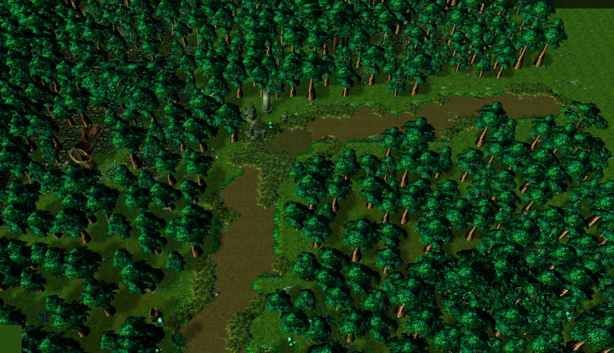
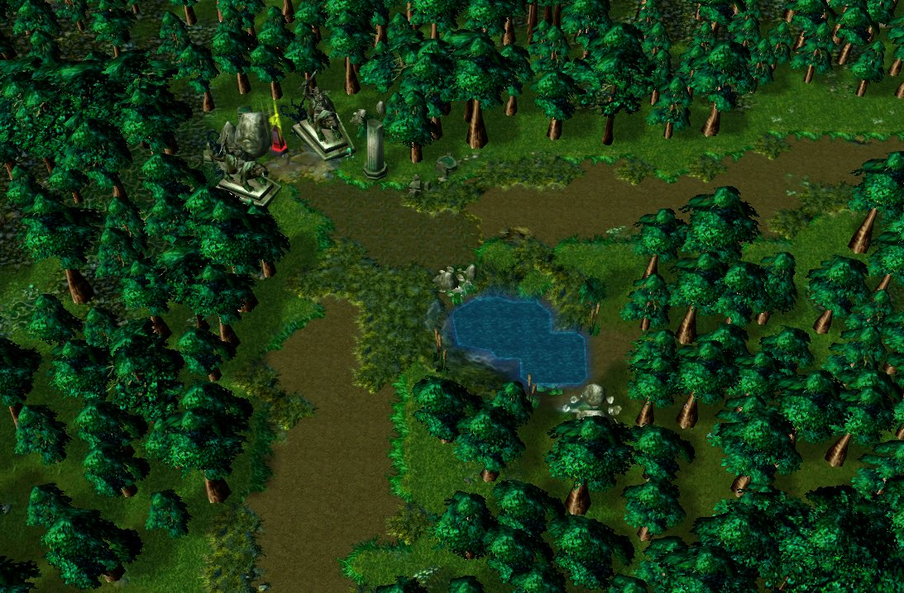
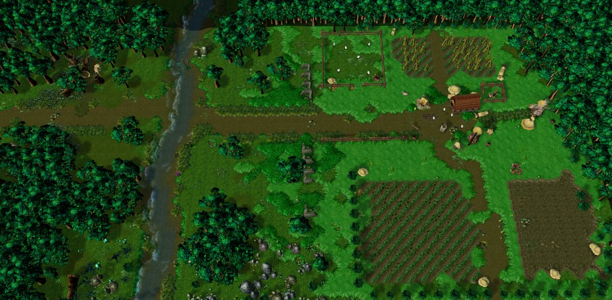
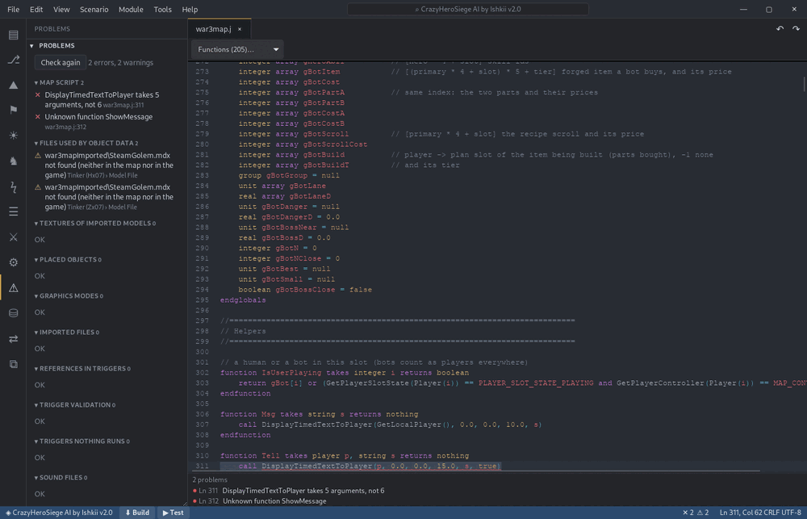
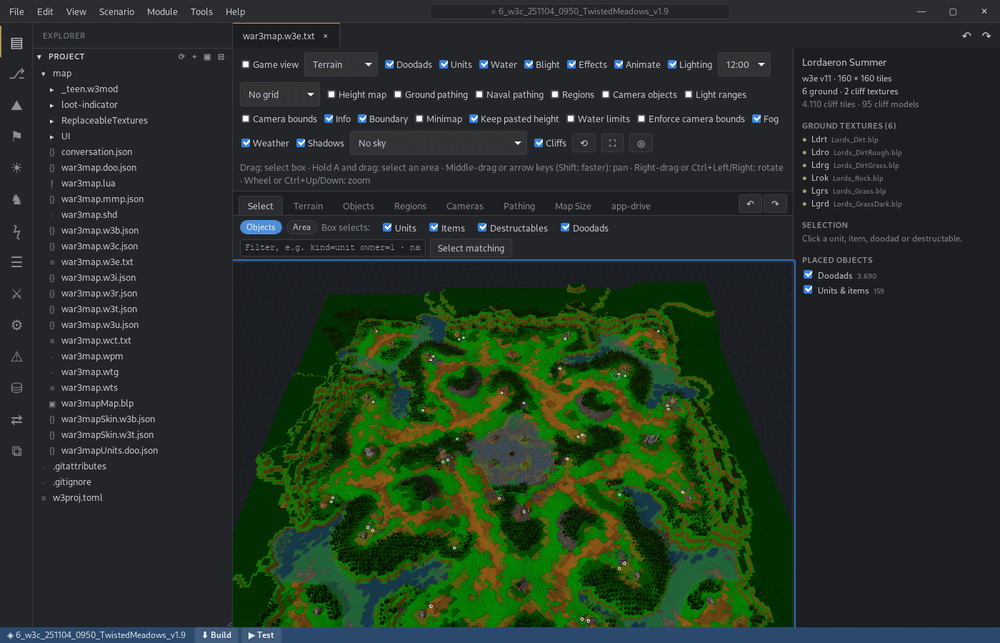

# W3Proj Studio

A remake of the Warcraft III World Editor, built with Rust and Tauri. It opens existing maps and
creates new ones, with its own terrain, object, trigger, sound and import editors.

Two things work differently from the original. A map lives in an unpacked project folder that
you can keep in git, and packing to `.w3x` is the last step before release. And nearly everything
is an extension, in the style of VS Code, so you can add to it or replace parts of it. AI clients
can also work on a map through a built-in MCP server.

It's a work in progress. Plenty of it hasn't been checked against the game yet.

This is an unofficial project, not affiliated with or endorsed by Blizzard Entertainment.
Warcraft is a trademark of Blizzard Entertainment. You need your own installed copy of the game.

## Features

What the World Editor doesn't have:

- **AI integration.** Performance and cost heavily depend on provided guides and used models. Examples were done with built-in guides and Claude Opus 5.5.

    **Example Forestpath:**

    | Image 1 | Image 2 | Image 3 |
    | :---: | :---: | :---: |
    | "can you familiarize yourself with warcraft mapping and use the war3-proj konnektor to build a nice forest in region 000, with a path from south to east." ~10min | "can you make the coner section more interesting" ~5min | "can you make a nice farm in region 001 and add a transition between it and the forest?" ~10min  |
    |  |  |  |


- **Problems view.** Checks the project like a compiler would: JASS errors in the map script, files that object
  data uses but nobody has, textures missing from imported models, placed objects of unknown types, imports
  without their file, triggers nothing runs. Click a problem to jump there; Build runs the checks first.

  

- **A map is a folder you can keep in git.** Unpacked projects store object data, map properties, placed objects,
  regions and the rest as JSON or text, so diffs and merges work; packing to `.w3x` is a release step. Every
  file is checked to pack back byte for byte. A Source Control view commits, diffs, branches, pushes and pulls,
  and automatic checkpoints keep packed copies to go back to.
- **VS Code's way of working.** Activity bar, side views, tabs, a command palette (Ctrl+Shift+P) for every
  command, quick file open (Ctrl+P), and settings per user or per project (`.w3proj/settings.json`, versioned with
  the map). Inside the terrain view the World Editor's keys and mouse still apply, and every key (undo and redo,
  the terrain view's and its mouse buttons and wheel included) can be changed in Keyboard Shortcuts (Ctrl+K Ctrl+S)
  or `keybindings.json`.
- **Extensions.** Nearly every editor is an extension on a public API; you can add commands, views, editors,
  settings, MCP tools and Problems checks, or turn a built-in off and replace it.
- **Editable binary formats.** The map file layouts are [format definitions](#format-definitions) (JSON), not
  code: a project can carry its own for a new patch or an unknown field.
- **Linux.** Runs natively; the game and the World Editor start through Steam's Proton when you test a map.
- **A command line.** `w3proj` unpacks, packs, verifies and inspects maps and the game's files, for scripts and
  CI ([CLI](#cli)).



## Caveats

- **Formats are mostly best guesses.** all of this migth brake with the next update. Always make sure you can open with WE.
- **It depends on Blizzard's game.**
- **Few users.** All of this migth work for my workflows, but brake in yours.

## How a map is stored

A `.w3x` is a 512-byte `HM3W` header (name, flags, max players) followed by an
MPQ archive. The archive holds files like:

| file | content | in the project |
|---|---|---|
| `war3map.j` / `.lua` | map script (triggers compile to this) | text, as-is |
| `war3map.w3u/.w3t/.w3a/.w3b/.w3d/.w3h/.w3q` | object data: unit/item/ability/… modifications | **JSON** (`*.json`) |
| `war3map.wts` | trigger strings (`TRIGSTR_xxx`) | text, as-is |
| `war3map.w3i` | map info: name, players, forces, options, fog, … (v18, v25–v39) | **JSON** (`war3map.w3i.json`) |
| `war3map.doo`, `war3mapUnits.doo` | placed doodads/destructables; units, items, start locations (v7, v8, v12, v13) | **JSON** |
| `war3map.w3e` | terrain | **text** (`war3map.w3e.txt`) |
| `war3map.wpm`, `.shd` | pathing, shadows (the terrain editor regenerates both) | binary |
| `war3map.w3r/.w3c/.w3s` | regions, cameras, sounds | **JSON** |
| `war3map.wtg` | GUI triggers, variables, categories | **JSON** (`war3map.wtg.json`; unpacking needs the game's `UI\TriggerData.txt`, packing doesn't) |
| `war3map.wct` | custom script: the map header and each trigger's text | **text** (`war3map.wct.txt`, one section per trigger) |
| `war3map.imp`, `war3mapImported\*` | imports | as-is |

Every codec is checked on unpack: a file is only stored as JSON or text if
`encode(decode(file))` gives back the original bytes. If not, it stays raw, so packing doesn't
lose anything. This was run over 676 local maps without a mismatch.

## Format definitions

The binary layouts aren't hard-coded. They're format definitions (JSON with `//` comments) that
one engine reads (`crates/w3proj/src/format`). The built-in ones are in
[crates/w3proj/formats/](crates/w3proj/formats/) (`w3i`, `doodads`, `units`, `regions`, `cameras`, `sounds` and others) and get compiled
into the CLI and the app. A definition lists fields with types, counts, `if` conditions
(`version >= 39`), plausibility `check`s and **variants** for layouts that differ without a
version bump (e.g. v39 player HUD skins, v8 doodads without skin ids): the engine tries each
reading and keeps the one that reproduces the file byte-exactly and passes the checks; ambiguous
choices are reported in the unpack output.

To adapt a format for a new patch or an unknown field, copy the definition into the project with
*Extensions → Formats → Customize* or `w3proj formats --show w3i > .w3proj/formats/w3i.json`,
edit it, and re-sync. Definitions in `.w3proj/formats` (project), the app's user `formats`
folder or `W3PROJ_FORMATS` (CLI) replace built-ins with the same `name`. `w3proj formats`
lists what's active. Files are still checked on unpack, so a wrong definition makes them fall back
to raw instead of breaking the map.

## Project layout

```
MyMap/
  w3proj.toml       map header + archive/pack settings
  map/              one file per archive file (object data as *.json)
  unnamed/          files of protected maps whose names can't be recovered (not packed)
  build/            pack output (git-ignored)
  build/checkpoints/  automatic packed copies (Restore Checkpoint…)
  .w3proj/extensions/   optional project-local extensions
  .w3proj/generated-script   hash of the map script the app wrote last (a script without
                    it isn't replaced if that would lose functions the triggers don't make)
  .gitattributes    map files byte-exact, text formats diffable, imported assets
                    (models, textures, sounds, videos, fonts) via Git LFS where installed
```

## Repository layout

```
crates/mpq       MPQ v1 reader/writer (zlib/bzip2/pkware, encrypted tables, deterministic output)
crates/casc      read-only CASC reader for the installed game (index, BLTE, encoding, text root,
                 mod layering SD/HD/DE + locale + FileAliases + .blp→.dds fallback)
crates/w3proj    project format, codecs, unpack/sync/pack/verify
crates/cli       `w3proj` command line
app/             Tauri desktop app
  src-tauri/     Rust backend (thin: exposes the core, files, launching WE/game)
  src/workbench/ VS Code-like shell: activity bar, views, tabs, palette, status bar, output
  src/extensions/api.ts       the public extension API
  src/extensions/services.ts  contracts of the services extensions provide each other
  src/lib/       shared code that belongs to no extension
    image/                 dependency-free BLP1/BLP2, DDS (BC1–5) and TGA decoders, incl. a
                           baseline + progressive JPEG decoder for BLP1's 4-channel JPEGs
    model/                 MDX parser (v800–v1800) and WebGL2 renderer (GPU skinning)
    formats/text.ts        SLK and INI parsing
    objects/metadata.ts    object data knowledge from the game (fields, names, defaults)
  src/builtin/   built-in extensions (explorer, text editor, object editor, texture viewer, map project, …)
    terrain-viewer/        w3e parser, ground/water renderer, cliffs, object placement, pathing map
```

Module boundaries (checked by `npm run check` and the build, `app/scripts/check-imports.mjs`):
an extension imports only its own files, `src/lib`, `src/extensions` and `workbench/dom`.
Functionality one extension offers others goes through a service, not an import.

## Build & run

Requires Rust (the toolchain version is pinned in `rust-toolchain.toml`), Node 22 (Vite 7 needs
20.19 or newer), and the system webview: WebView2 on Windows, WebKitGTK on Linux.

```sh
cargo test --workspace
cargo build --release -p w3proj-cli        # → target/release/w3proj(.exe)

cd app
npm ci                                     # also in every new git worktree
npm run check                              # types (app and tests) and module boundaries
npm test                                   # TypeScript unit tests (src/**/*.test.ts, node:test)
npx tauri dev                              # run the editor
npx tauri build                            # installer in target/release/bundle
```

**Release packages** come from the *Release* workflow (`.github/workflows/release.yml`, started by hand in
GitHub Actions): NSIS and MSI installers for Windows, AppImage and deb for Linux, each with the `w3proj` CLI
next to the app (the MCP bridge needs it there), and the bare CLI binaries, as workflow artifacts and, if asked
for, on a draft release. The same build locally (Linux shown; on Windows the CLI is `w3proj.exe` and the bundles
`nsis,msi`):

```sh
cargo build --release --locked -p w3proj-cli
mkdir -p app/src-tauri/binaries             # git-ignored
cp target/release/w3proj "app/src-tauri/binaries/w3proj-$(rustc -vV | sed -n 's/^host: //p')"
cd app && npx tauri build --bundles deb --config src-tauri/tauri.release.conf.json
```

### Linux

On Debian/Ubuntu one script installs everything above, plus what the app smoke test needs on Linux:

```sh
scripts/setup-linux.sh --check   # what's there and what's missing; changes nothing
scripts/setup-linux.sh           # install what's missing (asks for sudo for apt packages)
```

It sets up:

- **apt packages:** Tauri's build dependencies (`libwebkit2gtk-4.1-dev`, `libssl-dev`, `libxdo-dev`,
  `libayatana-appindicator3-dev`, `librsvg2-dev`, `build-essential`, …), plus `webkit2gtk-driver` and `xvfb`.
- **Rust** through rustup, at the pinned version.
- **Node 22** through [nvm](https://github.com/nvm-sh/nvm), not apt: Ubuntu's `nodejs` package is too old.
- **`tauri-driver`** (`cargo install tauri-driver --locked`, into `~/.cargo/bin`, which must be on `PATH`).
- **`npm ci`** in `app/`.

`scripts/setup-linux.sh --apt-packages` prints the apt package list; the CI workflows install the same list with it.
- **sccache** (optional): a compiler cache shared by this checkout and its worktrees, installed into
  `target/tools/` and wired up by a local, git-ignored `.cargo/config.toml`. Delete that file to build without it.
- **actionlint** (optional): checks the GitHub workflow files; a pinned release binary, checksum-verified, into
  `target/tools/bin/`.
- **Warcraft III:** finds the installs in Steam (Proton), Lutris/Battle.net and Wine prefixes, shows each one's
  build, and writes the newest to `.game-path` (git-ignored; `--game PATH` picks another). The gate and the test
  scripts read it when `W3PROJ_GAME` isn't set (`tests/gamepath.mjs`); on Windows, without either, they use the
  folder above the repository. The app itself takes the folder from its `game.installDir` setting: when that
  folder (by default `C:\Program Files (x86)\Warcraft III`) doesn't open, it offers the installs it finds in the
  same places at start, newest first. "Game Data: Choose Warcraft III Folder…" changes it later.

Use an up-to-date game: Studio's generated map scripts call natives of the current build, and an older one
(e.g. 2.0.x) rejects them.

Why the extra test tools: on Windows the smoke tests drive the app's WebView2 over the Chrome DevTools
Protocol. WebKitGTK doesn't speak that protocol, so on Linux they drive it over WebDriver
(`tauri-driver` → `WebKitWebDriver`), inside `xvfb-run`, so the app gets a display without a window
on your screen.

On Linux:

- **The game and the World Editor** (Test Map, Open in World Editor, and JassHelper for vJass) are Windows programs,
  started through **Steam's Proton**: the game has to be in Steam (a non-Steam game with Proton is fine) and
  run from there once. Studio then runs `proton runinprefix <exe>` with the Proton build Steam uses for it (from
  `steamapps/compatdata/<id>/config_info`), in the same prefix and with Steam's environment, so it's the setup
  Steam itself starts. (Steam can't pass a map to a game it starts itself, so Studio doesn't go through the Steam
  client. `proton run` isn't used: its steam.exe stays until every other program in the prefix, Battle.net
  included, has ended.) The programs follow `game.installDir` unless `game.path` / `worldEditor.path` are set.
- **The MCP server** uses a Unix socket in `$XDG_RUNTIME_DIR`, or `/run/user/<uid>` when a launcher leaves the variable out (only you can reach it), instead of the Windows
  named pipe; `w3proj mcp` connects to it the same way. "Try to set up for …" looks for clients in `~/.config`
  and the home folder.
- **Reveal in File Explorer** opens the file's folder with `xdg-open`.

### CLI

```sh
w3proj unpack MyMap.w3x MyMap/      # create or re-sync a project
                                    # (a re-sync that would delete files you added lists them and writes
                                    #  nothing; --allow-deletes deletes them)
w3proj pack MyMap/ [-o out.w3x]     # release build (default: MyMap/build/MyMap.w3x)
w3proj verify *.w3x                 # unpack→pack in memory, compare every file
w3proj ls MyMap.w3x                 # sizes, stored sizes, flags, table sizes
w3proj cat MyMap.w3x war3map.j
w3proj formats [--project MyMap/] [--show w3i]   # format definitions in use

# the installed game's own data (default install: C:\Program Files (x86)\Warcraft III)
w3proj game info                               # build, locale, layer order
w3proj game ls footman                         # stored files containing "footman"
w3proj game --mode hd resolve Units/Human/Footman/Footman.mdx
w3proj game cat Units/UnitMetaData.slk
```

### Tests

[TESTING.md](TESTING.md) has the test process. `node tests/gate.mjs` runs the checks for a commit.

GitHub Actions run them on every push: `ci.yml` on Windows (step by step) and on Linux (the gate itself, with
the apt packages from `scripts/setup-linux.sh --apt-packages`), without the game or the map corpus. `codeql.yml`
scans the TypeScript, Rust and workflow code on pushes and pull requests to `master` and `dev`, and weekly.
[actionlint](https://github.com/rhysd/actionlint) checks the workflow files:
`target/tools/bin/actionlint .github/workflows/*.yml` (installed by `scripts/setup-linux.sh`).

### Corpus checks

Real maps aren't in the repository (`smoketest_maps/` is ignored: size and third-party
content), so the conversions are checked against a local map folder:

```sh
# unpack→pack every map/campaign in the folder, and compare which codec reads each file
# with tests/corpus-baseline.tsv (a codec that silently falls back to raw fails too)
w3proj verify -q smoketest_maps --baseline tests/corpus-baseline.tsv
# after an intended change (new codec, new maps): rewrite the checked maps' lines
w3proj verify -q smoketest_maps --baseline tests/corpus-baseline.tsv --update-baseline

# the TypeScript copies of the text codecs (w3e, wct, wtg) give the same text and bytes as Rust
cd app && node scripts/twin-check.mjs ../smoketest_maps
```

Maps missing from the baseline are reported as new, not as failures. Both need the installed
game for TriggerData.txt (`--game` / `W3PROJ_GAME`).

### Game data

The app reads the game's files straight from the CASC storage in `Data/`:

- The **Game Data** sidebar lets you browse and search all ~94k stored files and open them
  read-only, so textures open in the Texture Viewer and SLKs and scripts in the text editor.
- The object editor shows every field that applies to an object, with World Editor labels
  (`uhpm` → "Hit Points Maximum (Base)") and the inherited value from the game tables;
  editing an inherited value creates the modification, ↺ resets it. Abilities and upgrades
  show one row per level. **+ New** picks the base object by name and suggests the next
  free id (`hfoo` → `h000`); **Open Object Editor…** (F6) creates missing object files.
- Extensions use `w3.game.read("Units\\UnitData.slk")` etc. Plain paths resolve like the
  game does: locale → art layer (`game.graphicsMode`: `hd`/`sd`/`de`) → base, with
  `FileAliases.json` and `.blp`→`.dds` fallback.
- Settings: `game.installDir`, `game.graphicsMode`.

### Model viewer

`.mdx` files (game data or imported into a map) open in a 3D viewer: animations with
speed and scrubbing, team colour, wireframe, per-geoset visibility, and the list of
textures with load status. It reads MDX v800 (classic) through v1800 (Reforged), including
HD skin weights and LODs (LOD 1–3 start hidden) and the HD team-colour mask. Textures are
looked up in the map first, then in the model's own game layer (`.blp`/`.tif` → `.dds`).
Particles and ribbons are drawn. Reforged's PopcornFX effects, lights and PBR lighting aren't yet.

### Terrain viewer

**F3** (or opening `war3map.w3e`) shows the map in 3D: ground textures blended the way the
game does (corner-mask tile atlas with variations), cliff models, water, and placed doodads,
destructables, units and items as models (from the game's skin tables; player colours for
units). Drag or arrow keys pan, right-drag rotates, the wheel zooms. Reads `w3e` v11 (classic)
and v12 (2.0). Raw `war3map.doo` / `war3mapUnits.doo` are decoded through the format engine
(`codec_decode`) when the project doesn't have them as JSON. Some of the rendering is approximated.

### Map properties

The **Scenario** sidebar (or F7) opens `war3map.w3i.json` as a form: description, loading and
prologue screens, map options, environment (weather, fog, water, camera zoom), players and
forces. Texts that live in the string table (`TRIGSTR_…`) are edited in `war3map.wts` directly,
changing only that string. Formats v25 (TFT) through v39 (3.0) are supported; v32–v39 follow
War3Net / wc3libs and are verified byte-exact against the game's own 3.0 campaign maps.

## Workflow with the World Editor

1. **Import .w3x as New Project…** (or **New Map…**, Ctrl+N, for an empty map), then commit the folder.
2. Edit the map in the app, or press **F5** (Open in World Editor) to use Blizzard's editor for
   something. That packs `build/<name>.edit.w3x`, starts
   `World Editor.exe -launch -loadfile <map>`, and watches the file. Each save
   in the World Editor syncs back into `map/`. The `project.syncOnWorldEditorSave`
   setting takes `ask`, `always` or `never`.
3. **Ctrl+Shift+B** packs the release `.w3x`. **Ctrl+F5** packs and starts the game with the map.

The editor and game paths are in *Preferences: Open Settings (JSON)*. They default
to `_retail_\x86_64`.

## Extensions

Nearly everything past the shell is an extension. Built-in and user extensions use
the same API (`app/src/extensions/api.ts`):

```
%APPDATA%\dev.w3proj.studio\extensions\<name>\extension.json + main.js
<project>\.w3proj\extensions\<name>\…
```

```json
{
  "id": "me.stats", "name": "Stats", "version": "0.1.0", "main": "main.js",
  "contributes": {
    "commands": [{ "id": "me.stats.run", "title": "Run Stats", "keybinding": "ctrl+alt+s", "menu": "Tools" }],
    "viewContainers": [{ "id": "stats", "title": "Stats", "icon": "∑" }],
    "views": [{ "id": "me.stats.view", "title": "Stats", "container": "stats" }],
    "editors": [{ "id": "me.stats.editor", "title": "Stats Editor", "patterns": ["*.w3i"] }]
  }
}
```

```js
export function activate(w3, ctx) {
  ctx.subscriptions.push(w3.commands.register("me.stats.run", () => w3.window.showInfo("hi")));
}
```

**The built-ins' code.** Extensions have no build step, so they can't import `src/lib`. They get
the same parsers, writers and checks from `await w3.lib()` (`app/src/extensions/lib.ts`):
`const { terrain, version } = await w3.lib();` Check `version`: it goes up when something there
changes in a way that breaks extensions.

**MCP tools.** AI clients use the editor through one server, and any extension can add tools to
it. Declare the tool in `extension.json`, which lists it without loading the extension, and
answer it in `activate`:

```json
"contributes": { "mcpTools": [
  { "name": "my_tool", "description": "What the AI reads to decide when to use it.", "readOnly": true,
    "inputSchema": { "type": "object", "properties": { "x": { "type": "integer" } } } }
] }
```

```js
ctx.subscriptions.push(w3.mcp.registerTool("my_tool", async ({ x }) => `got ${x}`));
```

A handler returns text, `{ type: "image", data: base64, mimeType }`, or anything else, which goes
out as JSON. Throw to report a failure: it ends that one call and nothing else. The extension
activates on the first call. If it's disabled, its tools aren't listed. Tools that aren't
`readOnly` need the setting `mcp.writeTools`, and tools of project extensions need
`mcp.projectTools`, because a map from someone else could bring any tool.

Tools that change a project go through the service `w3.mcpEdits`, not the workspace:

```js
const edits = await w3.services.get("w3.mcpEdits");
await edits.edit("Rename the thing", async (read) => {
  const text = await read("map/war3map.wts");
  return [{ path: "map/war3map.wts", text: text.replace("Old", "New") }];
});
```

That makes the change undoable and takes a checkpoint first. It refuses while anything in the app
is unsaved, and anything outside `map/`.

**Replacing built-ins.** Every built-in can be turned off: `"extensions.disabled": ["w3.objectEditor"]`
in settings (or the Disable button in the Extensions view; applies after a reload). To make a
different editor the default for some files without disabling anything, map a glob to an editor
id: `"editorAssociations": { "*.w3u.json": "my.objectEditor" }`, or use *Configure Default Editor
for This File Type…*. Extensions with an id that is already taken are skipped (see the Extension
Host log), so a replacement uses its own id plus one of these two settings.

Extensions activate lazily: a contributed command, view or editor activates
its extension on first use. `"activationEvents": ["onStartup"]` loads it
immediately. *Extensions: Create Sample Extension* writes a working example.

**Settings.** Extensions declare settings in `contributes.configuration` (type, default,
description, minimum/maximum, enum) and read them with `w3.settings.get(key)`. Values come from
the open project (`.w3proj/settings.json`, versioned with the map), then the user
(`%APPDATA%\dev.w3proj.studio\settings.json`), then the declared default; settings with
`"scope": "user"` (paths, lists) ignore the project layer. *Preferences: Open Settings* (Ctrl+,)
edits either layer; the map tools' parameters live under `terrain.*` (pathing, shadows, minimap).

```json
"configuration": { "title": "Stats", "properties": {
  "stats.limit": { "type": "integer", "default": 10, "minimum": 1, "description": "Rows to show." }
} }
```

**Keys.** A command's `keybinding` is its default key; more keys, or keys that apply only somewhere, go in
`contributes.keybindings` (`{ "key": "ctrl+k ctrl+s", "command": "…", "when": "terrainFocus" }`, as VS Code's).
*Preferences: Open Keyboard Shortcuts* (Ctrl+K Ctrl+S, the World Editor's Configure Controls) lists every command with
its keys, records a new key by pressing it, removes one, resets a command and shows keys bound twice; it writes
`keybindings.json` next to `settings.json` (a list of `{ key, command, when }`; a command written `-id` takes a default
away), which can be edited by hand and applies at once. Context keys for `when`: `project`, `editor`, `inputFocus`, and
those of the elements around the one with the keyboard (`data-key-context`): the terrain view's keys, the World Editor's
by default, are all under `terrainFocus`, and the view reads them with `w3.keybindings.commandsFor(event)`; an editor
with its own undo says `undoKeys`, where Ctrl+Z, Ctrl+Y and Ctrl+Shift+Z are Undo and Redo's keys. The mouse has keys
too, as the World Editor's Configure Controls: `leftbutton`, `middlebutton`, `rightbutton`, `wheelup`, `wheeldown`, with
modifiers (`alt+leftbutton`); the terrain view reads them with `w3.keybindings.mouseCommandsFor(event)` (its camera's
Translate and Rotate, the selection's Move and Rotate to the pointer, the wheel's zoom).

**Services and dependencies.** An extension shares functionality by declaring
`"contributes": { "services": [{ "id": "me.thing" }] }` and calling
`w3.services.provide("me.thing", impl)` in `activate`. Users call
`await w3.services.get("me.thing")` (which activates the provider) and list the
provider in `"extensionDependencies": ["me.provider"]`. If a dependency is
disabled or missing, the dependent fails to activate with a message naming it
(Extensions view). Built-in services:

| Service | Provider | What |
|---|---|---|
| `w3.objects` | Object Editor | `pick(host, { title, kinds })`: the object browser (search, facets, field filters, the map's custom objects), one tab per kind; `icon(kind, id)` |
| `w3.terrain` | Terrain Viewer | `registerToolGroup(group)`: a tab in the terrain editor with its own toolbar, pointer/key handlers, ground overlay, pathing filter and save hook; the handle exposes terrain strokes, ground tiles and placed objects |

The terrain editor itself only does view, selection, undo and saving; its tools are sub-extensions
that use `w3.terrain`: Terrain Painter (`terrain-painter`), Object Placer (`terrain-objects`) and
Pathing Editor (`terrain-pathing`, overrides in `.w3proj/pathing.json`).

## Known limits / next steps

- `wpm` and `shd` are stored raw, as derived data. New codecs plug into
  `crates/w3proj/src/codec.rs` and get checked automatically.
- Game data is read-only, and only files stored locally can be read (other
  locales aren't downloaded). Encrypted CASC entries aren't supported; none
  are present in 3.0.1.
- Files of protected maps whose names were stripped can't be repacked.
- Archive names that aren't UTF-8 (rare, old Asian-locale maps) are not recovered.

## Credits

Most of what's known about these file formats comes from people who worked it out and published
it. The formats here were built from their work and then checked against real maps:

- [wc3libs](https://github.com/inwc3/wc3libs), mainly by WaterKnight and Frotty, and its
  [notes on the 3.0 map formats](https://github.com/inwc3/wc3libs/blob/master/docs/warcraft-iii-3.0-map-formats.md)
- [War3Net](https://github.com/Drake53/War3Net) by Drake53
- [WC3MapSpecification](https://github.com/ChiefOfGxBxL/WC3MapSpecification) by ChiefOfGxBxL
- [HiveWE](https://github.com/stijnherfst/HiveWE) by stijnherfst, for its wiki page on the terrain format
- [mdx-m3-viewer](https://github.com/flowtsohg/mdx-m3-viewer) by flowtsohg, for how terrain is drawn

The guides the AI tools read follow Blizzard's
[designer note on competitive melee maps](http://classic.battle.net/mod/dev/melee.shtml), and
community tutorials and reviews from [Hive Workshop](https://www.hiveworkshop.com/),
[TheHelper](https://world-editor-tutorials.thehelper.net/), [Elil's Terrain FAQ](https://www.elilz.com/terrain.html)
and [warcraft3.info](https://warcraft3.info/articles/423). Their numbers were measured on ladder maps.

The MPQ Huffman tables come from [wow-mpq](https://github.com/wowemulation-dev/warcraft-rs), which
has them from [StormLib](https://github.com/ladislav-zezula/StormLib) by Ladislav Zezula. They're
used under the MIT license; the notice is in `crates/mpq/src/huffman_tables.rs`.

## License

MIT, see [LICENSE](LICENSE).
